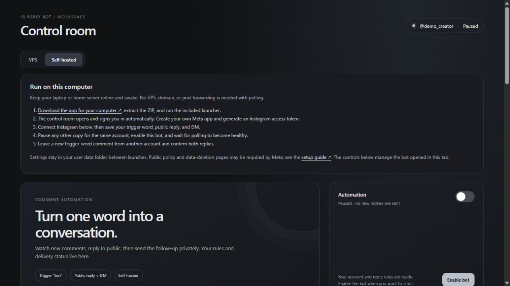

# IG Reply Bot

Turn an Instagram comment into a public reply and a DM. Connect your account, choose a trigger word, and control the bot from a browser interface.

[Download the app](https://github.com/1295pro/ig-replybot-dev/releases/latest) · [Setup guide](docs/USER_GUIDE.md) · [Quick start](docs/QUICK_START.md) · [MIT license](LICENSE)



*Example profile shown in the control room.*

## Start on your computer

1. Download the ZIP for your operating system from **Releases** and extract it.
2. On Windows, double-click **start-local.cmd**. On macOS, open **start-local.command**. On Linux, run **./start-local.sh**.
3. The control room opens in your browser and signs you in automatically.
4. Connect Instagram using an access token from your own Meta app.
5. Save your trigger word, public reply, and private message. Choose **Self-hosted** to keep the bot on this computer.
6. Enable the bot. Once polling is healthy, leave a **new** trigger-word comment from another account and check for both replies.

The laptop needs to stay awake, online, and running the app. Comments are checked every minute by default. Polling works on a normal home connection; a static IP, public domain, or VPS is optional.

For example, with the trigger `bot`, a new comment saying `BOT!` receives your public reply followed by one DM. `I want a bot` does not match. Existing comments form the first-run baseline and are not answered.

Windows builds are unsigned. Windows 11 Smart App Control can block them without offering a per-app exception. Check the [Windows launch limitation](docs/USER_GUIDE.md#windows-launch-limitation) before choosing the Windows download.

## What you need from Meta

Use an Instagram **Business or Creator** account and your own Meta developer app with Instagram Login. The token needs `instagram_business_basic`, `instagram_business_manage_comments`, and `instagram_business_manage_messages`. The account connection form links to Meta's dashboard and checks your token for you.

Creating the Meta app, obtaining its token, and any required App Review happen in Meta's dashboard. Permission requirements depend on the accounts your app serves. Ordinary commenters do not need to be app testers. See the [Meta setup steps](docs/USER_GUIDE.md#connect-instagram).

## Run continuously on a VPS

Start the app on your computer and save your account and reply settings. Choose **VPS**, enter your server details, check its SSH fingerprint, and follow **Check server → Deploy and run checks**.

The installer supports Ubuntu/Debian on x64 or ARM64. It creates a separate Docker project, checks Meta polling, and gives you the command to open the server's control room. Pause the laptop copy before deploying. The VPS keeps working after your laptop is closed.

[Full VPS walkthrough](docs/USER_GUIDE.md#move-to-a-vps)

## Your data

Settings survive app restarts in your user data folder. The app uses Meta's official API and keeps your token, reply settings, comment IDs, and delivery status on the computer or VPS running it. Tokens and saved secrets are not encrypted at rest. Keep that device and its backups private.

Meta controls account eligibility, token expiration, permissions, API limits, and message delivery. Tokens currently need manual renewal. Each instance handles one Instagram account. Failed or uncertain message deliveries are shown for review rather than automatically resent.

## Build from source

Install [Rust](https://rustup.rs/), clone this repository, and run:

```sh
cargo run --release --locked -- --local
```

Windows users can also double-click `start-local.cmd` in the source folder. Building on Windows requires the Microsoft C++ build tools requested by Rust. Ready-to-run release downloads include the compiled app.

[Developer and manual service reference](docs/ADVANCED.md) · [Architecture](docs/ARCHITECTURE.md) · [Validation report](docs/RELEASE_VALIDATION.md) · [File map](docs/USER_GUIDE.md#file-map)
